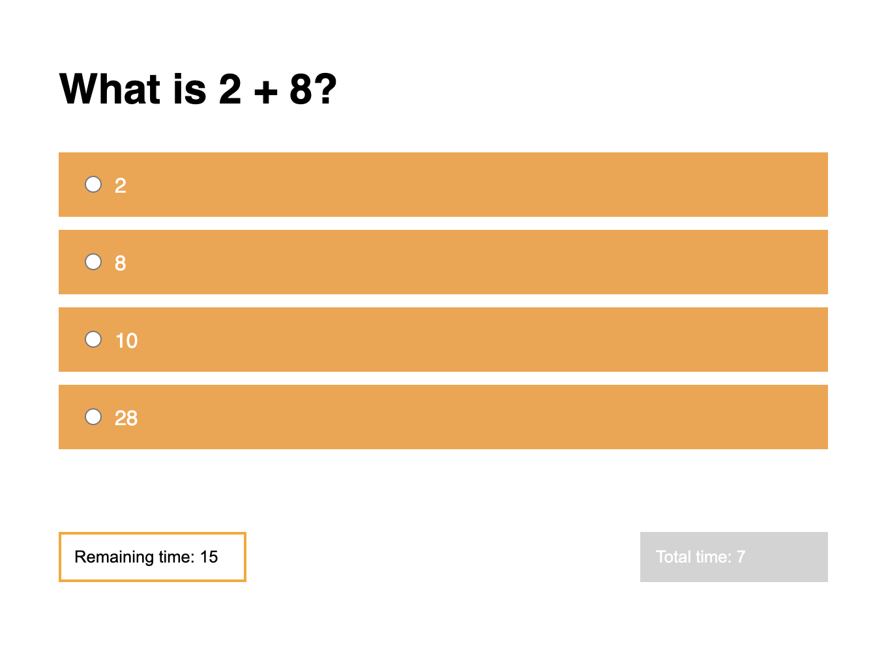

# &lt;my-app&gt;

A web component for my quiz application. This 
webcomponent contains four other components. It lets the player choose a username, fetches quiz questions, allows the player to submit answers, and tracks high scores based on the time it takes the player to finsih the quiz.

## Attributes

The following attributes are used in the `my-app` web component:

- `time`: Defines the time limit (in seconds) for each quiz question. Default is `20` seconds.

## Methods

`endQuiz()`
- Ends the quiz, stops the countdown timer, hides quiz-related UI elements, and displays the high score list.

`fetchQuestions()`
- Fetches quiz questions from the server. It retrieves the question data, sets the time limit, and updates the DOM with the question and choices.

`postAnswer(url, data)`
- Sends the player's answer to the server. Based on the response, it either proceeds to the next question, ends the quiz on a wrong answer, or notifies the player of their win.

`reset()`
- Resets the game, reinitializes the timer, and prepares the quiz UI for a new round.

`saveWinner()`
- Saves the player's nickname and score to the high score list in localStorage.

`renderHS()`
- Renders the top 5 players from the high score list.

## Properties

- `#nextURL`: The URL for fetching the next question in the quiz. Starts with `'https://courselab.lnu.se/quiz/question/1'`.
- `#abortController`: An instance of `AbortController` used to manage fetch cancellation.

### DOM Elements:
- `appContainer`: The main container for the app.
- `quizContainer`: The container for displaying quiz questions and choices.
- `quizQuestion`: The container for displaying a single quiz question.
- `nickname`: A custom element for inputting the player's nickname.
- `timer`: A custom element for displaying the countdown timer.
- `highscore`: A custom element for displaying the high score list.
- `question`: A custom element for rendering the current quiz question.

## Events

- `nicknameSubmitted`: Triggered when the user submits their nickname. The nickname is stored in `sessionStorage`.
- `answerSubmitted`: Triggered when the player submits an answer. The answer is sent to the server for validation.
- `correctAnswer`: Triggered when the player answers a question correctly. The next question is fetched from the server.
- `wrongAnswer`: Triggered when the player answers a question incorrectly. The quiz ends.
- `timesup`: Triggered when the timer runs out. The quiz ends.
- `youWon`: Triggered when the player answers all questions correctly. A congratulatory message is displayed, and the player's score is saved to the high score list.
- `playAgain`: Triggered when the player decides to play again. The quiz is reset, and the game starts over.

## Example

```html
<my-app></my-app>
```


