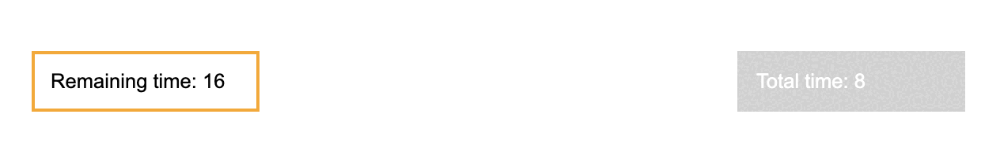

# &lt;my-countdown&gt;

A web component for a countdown timer. The timer counts down to 0 and also counts to total time elapsed.

## Attributes
`time` The time from which the countdown starts.


## Methods
`countDown()`
Starts the countdown timer.

`stopCountDown()` Stops the countdown timer.


`reset()` Resets the timer and counter to default values.

## Properties

`totalTime` Returns the total time elapsed.

## Events
`timesup` Dispatched when the countdown timer reaches zero.

## Example

```html
<my-countdown></my-countdown>
```


