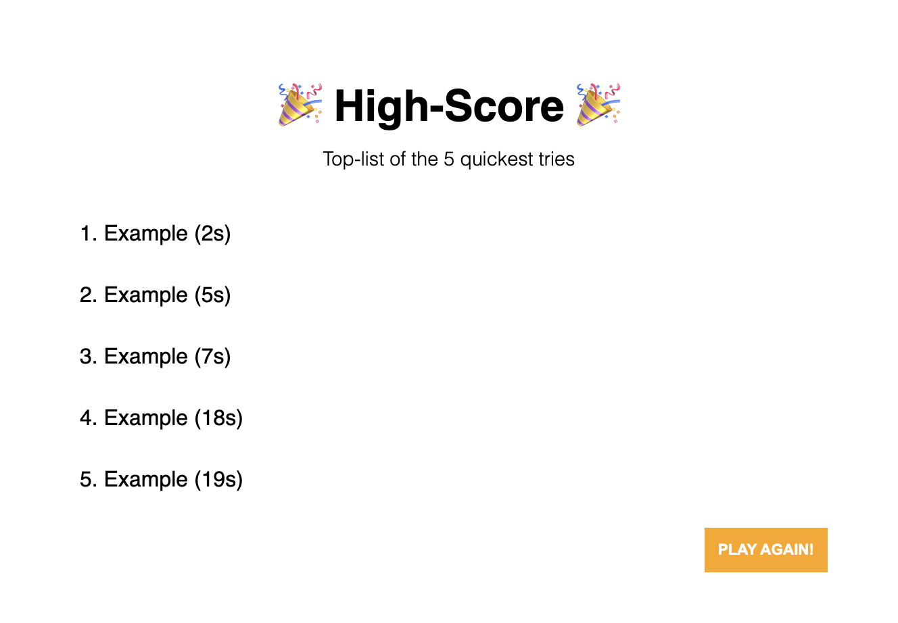

# &lt;my-highscore&gt;

A web component for showing a highscore list.

## Methods
`render(highscore)`
Renders the highscore list based on the data we send in.

**Parameters**
`highscore` (Array): An array containing all the objects containing `nickname` and `score`.

## Events
`playAgain` Dispatched when the "Play Again" button is cliecked.

## Example

```html
<my-highscore></my-highscore>
```


